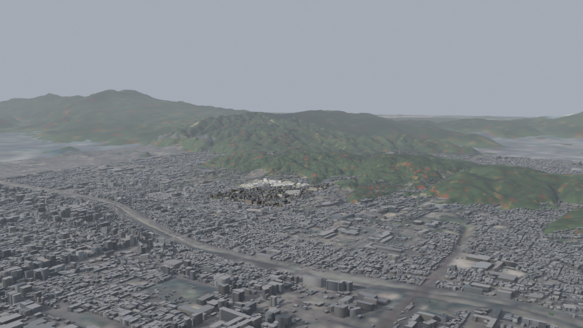

# Phase 10 — Distant backdrop (real surroundings)

Beyond the 400 m box, and its +100 m margin, the scene used to end in a void or a flat plane that read like a sea. Kyoto has no sea.
Collection **`95_Distant_Backdrop`** replaces that with the real surroundings, built from survey data:

* the Kyoto basin and the Higashiyama range as GSI DEM terrain out to ±15 km;
* the surrounding city as PLATEAU 2025 building massing;
* the forested hill slopes as a canopy surface.



| check render (960×540, Cycles, blockout scene) | |
|---|---|
| `renders/backdrop_check_aerial_sw.png` | the blockout's `Cam_Aerial_SW`. The backdrop shows at the top of the frame, and the city continues seamlessly past ±300 m |
| `renders/backdrop_check_yasaka_east.png` | local (−79, 88.2, ground + 1.6) looking east up Yasaka-dōri at the pagoda. With the blockout's box massing, the street buildings and the PLATEAU-box pagoda hide the ridge completely. Geometrically, the ridge is ~10–11.5° above the eye, at about the height of the pagoda's 2nd–3rd roof |
| `renders/backdrop_check_yasaka_east_nostreet.png` | the same camera with `30_*` / `40_*` hidden (pagoda kept): the real Higashiyama ridge (Ryōzen – Kiyomizu-yama) stands behind the pagoda |
| `renders/backdrop_check_wide_ene.png` | from 650 m over Shimogyō looking ENE: the PLATEAU city, the inner box, Higashiyama, and the Hiei-zan / basin rim on the horizon |

## Pipeline

```
/home/user/venv/bin/python pipeline/backdrop_plateau.py luse 523536 523546          # land use -> forest
/home/user/venv/bin/python pipeline/backdrop_plateau.py bldg 52353670 … 52354614     # 25 bldg meshes (list: MESHES in 10_backdrop.py)
/home/user/venv/bin/python pipeline/10_backdrop.py [render] [web]                    # GSI tiles fetched/cached on first run
/home/user/venv/bin/python blender/build_backdrop.py [--no-render] [--no-glb] [--samples N] [--shots a,b]
```

* `pipeline/backdrop_plateau.py` streams the members it needs from the 2.7 GB Kyoto PLATEAU zip with HTTP Range requests (`remotezip.py`); about 120 MB is transferred in total. It caches compact npz files in `data/raw/plateau/backdrop/`, which is git-ignored.
* `pipeline/backdrop_gsi.py` handles the GSI XYZ tiles. Mosaics and samplers work in Web-Mercator pixel space. The tile cache is `data/raw/gsi/backdrop/`.
* `pipeline/10_backdrop.py` produces:
  * `data/processed/backdrop_render.npz` and `backdrop_web.npz`, with per-object `V` (float32 local x/y/z), `F` (triangles) and `C` (sRGB uint8 vertex colour);
  * `backdrop_meta.json`, with sources, ring specs, object list, city stats, landmarks and the forest rule.
* `blender/build_backdrop.py` provides `add_backdrop(scene, detail="render"|"web", haze=0.35, extend_clip=True, hide_conflicting=True)` and `export_glb(path)`.

## Sizes

| detail | object | vertices | triangles | artistic |
|---|---|---:|---:|---|
| render | Backdrop_Terrain_A_4m | 234 624 | 466 032 | no |
| render | Backdrop_Terrain_B_12m | 228 480 | 452 928 | no |
| render | Backdrop_Terrain_C_72m | 172 032 | 340 368 | no |
| render | Backdrop_Canopy_A / B / C | 247 230 | 470 033 | **yes** |
| render | Backdrop_City_LOD2 (9 840 bldgs) | 371 192 | 363 092 | no |
| render | Backdrop_City_LOD1 (59 739 bldgs) | 1 245 165 | 1 125 687 | no |
| render | **total** | | **3 218 140** | |
| web | Backdrop_Terrain_A_12m / B_48m / C_252m (canopy merged) | 57 832 | 111 632 | yes (canopy part) |
| web | Backdrop_City_LOD1 + LOD2 (6 274 bldgs) | 92 123 | 79 538 | no |
| web | **total** | | **191 170** | |

The files are:

* `web/assets/backdrop.glb`: 3.56 MB, 5 meshes, 7 primitives. It passes gltf-validator with 0 errors and 0 warnings.
* `data/processed/backdrop_render.npz`: 25 MB.
* `data/processed/backdrop_web.npz`: 1.6 MB.

A full Blender build of the render backdrop takes about 15 s. Each 960×540 check render takes about 1 min on 3 CPU threads with 16 samples.

## Frame and extents

The local frame is the project's own: x east, y north, z absolute T.P. metres, origin EPSG:6674 E −20160 / N −111160.
All rings are squares centred on the box. The inner ±300 m is a **hole**, filled by `Terrain_GSI_DEM5A` (2 m, `terrain.npz`).

| ring | extent (half-size) | render grid | web grid | height source | colour source |
|---|---|---|---|---|---|
| A | 300 → 1 008 m | 4 m | 12 m | GSI DEM5A z15 (5 m laser), DEM10B z14 fill | GSI seamlessphoto z16 |
| B | 1 008 → 3 024 m | 12 m | 48 m | same | seamlessphoto z16 |
| C (horizon) | 3 024 → 15 120 m | 72 m | 252 m | GSI DEM10B z12 (~31 m px) | seamlessphoto z12 |
| City | 5 × 5 third-order meshes 5235367x … 5235461x (lon 135.750–135.8125 E, lat 34.975–35.017 N ≈ x −2.65…+3.05 km, y −2.53…+2.08 km) | all buildings | filtered | PLATEAU 2025 | ortho roofs + PLATEAU-texture walls |

**Seams are crack-free by construction.**

* Each ring's grid starts one step outside its hole. A zipper strip then joins that grid to *copies of the previous ring's outer-loop vertices*, so the positions are bit-identical.
* Ring A zips onto the 2 m boundary vertices of `terrain.npz` and uses their exact heights.
* Between 300 and 420 m, the difference between the DEM resampling and `terrain.npz` (mean −0.1 m, max 0.33 m) is faded out.
* A 3 m skirt hangs under the inner seam in case another pass changes the inner terrain.

**Other terrain details.**

* **Earth curvature.** Curvature plus refraction is applied, viewer-centred: z −= d²/2R·(1−0.13). That is 0.007 m at 300 m, 0.7 m at 3 km and 15 m at 15 km.
* **Anti-aliasing.** DEM and orthophoto are Gaussian pre-filtered to each grid step before sampling.
* **What the horizon ring holds.** It contains Hiei-zan (848 m) to the NE, the Nishiyama / Arashiyama rim and Atago-yama (924 m) to the W/NW, and Lake Biwa behind the Higashiyama ridge, which cannot be seen from the box.

## City (PLATEAU 2025 Kyoto, `udx/bldg`)

* **Source.** 69 579 buildings from 24 meshes (52354614 has no buildings). The 1 268 buildings already in `buildings.json`, i.e. the inner ±300 m of 52353692, are excluded by gml id. Buildings from the north neighbour 52354602 that fall inside ±300 m are *included*, because the inner build only read 52353692.
* **Geometry.**
  * LOD1 solids: a prism from the bottom ring, with height = PLATEAU zmax − zmin as surveyed.
  * LOD2 Roof/Wall surfaces are used for every building that has them within 1.3 km of the centre, and for every structure taller than 45 m anywhere.
  * This matters for **Kyoto Tower**: in PLATEAU, LOD1 is only the 33 m podium, while LOD2 carries the 130.5 m tower, which sits at local (−1823, −1137). Kyoto Station (66.3 m) and the other station-area towers also get LOD2.
  * Kiyomizu-dera's halls, including the Sanjūnotō (probably `bldg_8790a27f…`, 22.3 m, local (429, −304)), have **no LOD2 in PLATEAU**. They appear as LOD1 prisms. Nothing was invented.
* **Placement.** Each building is set on the backdrop terrain at the minimum ground height under its footprint, minus 0.4 m (ring A) or 1.0 m (ring B), so it never floats. For web the sink is 0.8 / 2.5 m. Surveyed heights are kept.
* **Roof colour.** The median of the GSI seamlessphoto z16 pixels inside the footprint (measured). It is muted: saturation ×0.55 and luminance ×0.8, clamped to 40–140 sRGB, because orthophoto roofs read brighter than kawara albedo.
* **Wall colour.** Drawn deterministically (crc32 of the gml id) from the *measured* mean PLATEAU-texture wall colours of the inner mesh 52353692, bucketed by storeys (≤2 / ≥3). This is statistically assigned, not per-building measured.

## Forest and canopy

* **Extent (measured).** PLATEAU 2025 Kyoto land use (`udx/luse` 523536 + 523546), class **203 山林（樹林地）**. This is the 都市計画基礎調査 land-use survey, rasterised at 4 m (±3.1 km) and 32 m (±15.2 km).
* **Fallback (heuristic).** Where luse has no polygon at all — the Higashiyama interior NE of Daimonji, Shiga, and the far rim; 16 % of the 6 km area and 87 % of the 30 km area — forest comes from an orthophoto-colour heuristic: 2G−R−B > 12, luminance < 120, G ≥ R, and a 5-px median.
* **Canopy (ARTISTIC, `artistic=True`).**
  * Surface: terrain + 12–20 m (multi-octave value noise at 90 / 31 / 11 m). It tapers to the ground over 25 m inside the forest edge and is suppressed within 310–360 m of the centre, where the documented inner trees take over.
  * Colour: a late-autumn palette that matches `art_direction.md` §3. Evergreen cedar / hinoki / broadleaf dominate, with ~7 % maple and ~7 % yellow-brown tree-group speckle, all modulated by the measured orthophoto brightness.
  * Render detail: separate `Backdrop_Canopy_{A,B,C}` objects that sink 0.8 m below the ground at the forest edge. Web detail: the canopy is merged into the terrain heights and colours.

## Measured vs artistic

| element | measured | artistic / inferred |
|---|---|---|
| terrain heights | GSI DEM5A / DEM10B (bare earth) | earth-curvature drop (geometric), seam fade ≤ 0.33 m |
| terrain colour | GSI orthophoto (white-balanced: grey-world gains 1.038 / 0.975 / 0.989) | tone curve (γ 1.25, ×0.92, built-up −25 %, warm shift) and ±6–13 % per-vertex luminance jitter so coarse grids do not read as a water sheet |
| buildings | PLATEAU footprints, heights, LOD2 roofs where present | sink below ground; web footprint simplification |
| roof colour | orthophoto median | muting |
| wall colour | inner PLATEAU textures (distribution) | assignment per building |
| forest extent | PLATEAU luse 203 | ortho heuristic outside luse coverage |
| canopy height and colour | — | entirely artistic |
| haze | — | material mix toward `BackdropHaze` with camera distance |

## Blender (`add_backdrop`)

```python
import sys; sys.path.insert(0, "/home/user/kyoto-3d-render-test/blender")
from build_backdrop import add_backdrop
coll = add_backdrop(bpy.context.scene, detail="render")   # rebuilds 95_Distant_Backdrop if it exists
```

* **Objects (render detail):** `Backdrop_Terrain_A_4m`, `_B_12m`, `_C_72m`, `Backdrop_Canopy_A/B/C`, `Backdrop_City_LOD2`, `Backdrop_City_LOD1`.
* **Custom properties.**
  * On each object: `source`, `artistic`, `kind`, `detail`, `grid_step_m`, `ring_extent_m`, `exclude_web`.
  * On the collection: `sources` (JSON), `forest_rule`, `frame`, `earth_curvature`, `artistic_parts`.
* **Materials.** `BD_Terrain`, `BD_Canopy` and `BD_City` take the colour attribute `Col` (linear) into a Principled BSDF. A Mix Shader blends toward an emission of node **`BackdropHaze`** (RGB) with factor `BackdropHazeAmount · (1 − exp(−d / BackdropHazeDistance))` (defaults 0.35 and 9 000 m). This is subtle aerial perspective that lighting presets can retune or set to 0 when the world already has volumetric haze. Terrain and canopy have faint shading-only noise bumps.
* **`extend_clip=True`** raises every camera's `clip_end` to 40 km. The blockout cameras use 2 km, which would cut the backdrop.
* **`hide_conflicting=True`** hides older `Backdrop_DEM10B_*` placeholder objects. Those come from `kit_backdrop.py`: artistic land cover in `90_Backdrop_Outside_Boundary`, which would otherwise overlap this measured backdrop. Buildings in that collection, the inner ±300 m margin from `build_world.py`, are untouched.
* The script mode opens `higashiyama_blockout.blend` and **never saves it**.

## Web (`web/assets/backdrop.glb`)

* **Writer.** A custom compact writer, not the Blender exporter:
  * Y-up (x, T.P. height, −north), absolute coordinates like `world.glb`;
  * POSITION float32 and COLOR_0 RGBA8 normalised (linear);
  * uint16 indices, with objects split into ≤65 535-vertex primitives;
  * **no normals**, so three.js GLTFLoader flat-shades, as with `world_art.glb`;
  * one material.
* **Extras.** Node extras carry `source`, `artistic`, `kind` and `grid_step_m`. The scene extras carry the frame, the inner hole, all sources and the forest rule.
* **Web filter.** Every building within 600 m (footprints simplified 0.8 m, ≤12 vertices). Beyond that, only massing that rises above the low-rise roofscape: ≥12 m and ≥150 m², or ≥1 500 m², or >45 m. These are simplified 2 m, with ≤6 vertices or a minimum rotated rectangle. The low-rise city beyond 600 m is carried by the orthophoto colours of the terrain. Kyoto Tower and the other >45 m structures keep LOD2.
* **The page has not been updated.** `web/src` / `build.mjs` belong to the web workstream and do not load the file yet. To display it they need to: load it as a second GLB; give it no collider; make the camera far plane reach ≥ 16 km (or fade it with the existing height fog); and optionally run it through `build.mjs` meshopt.
