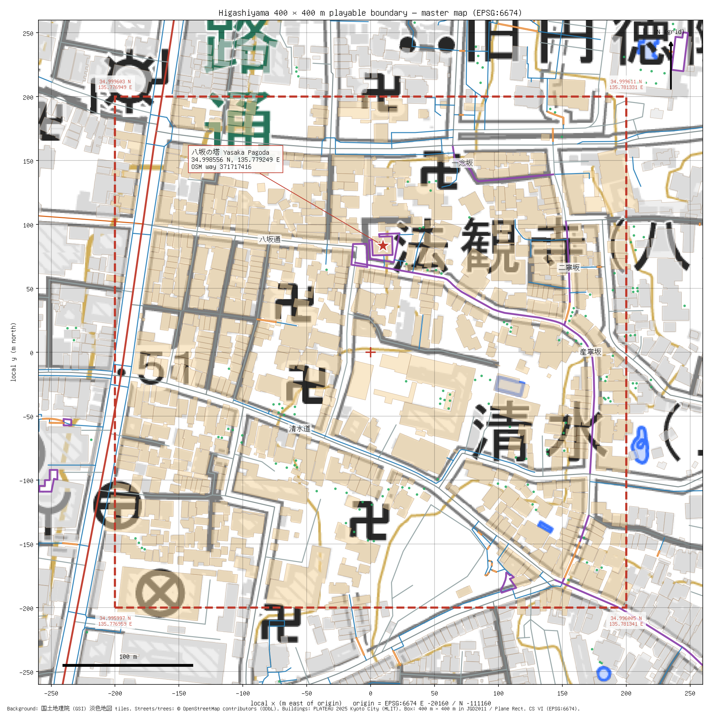

# Phase 1 — Geographic boundary (master layout)

Aerial alignment check: [master_map_aerial.png](master_map_aerial.png)

## Yasaka Pagoda (八坂の塔, Hōkan-ji 法観寺)

| item | value | source |
|---|---|---|
| Feature | OSM way **371717416** (`building=pagoda`, `name=八坂の塔`, `height=46`, `heritage:wikidata=Q858308`) | OpenStreetMap |
| Footprint centroid (WGS84) | **34.9985565 N, 135.7792488 E** | computed from OSM polygon |
| Footprint centroid (EPSG:6674) | E −20150.33 m, N −111076.54 m | pyproj |
| Footprint area (OSM) | 172.1 m² | OSM polygon |
| PLATEAU building | `bldg_2b477621-2b5c-480b-a960-d2b3972db237`, roof-edge area 229.2 m², ground 61.04 m T.P. | PLATEAU 2025 |
| Ground elevation | 61.4 m T.P. (DEM5A), 61.04 m (PLATEAU LOD1 base) | GSI / PLATEAU |
| Height | **38.8 m incl. sōrin (adopted)** — NDL reference entry; consistent with PLATEAU LOD2 top-roof apex 28.7 m above ground + ~10 m sōrin measured from photo ratios. The popular figure 46 m (also the OSM `height` tag) would require a ~17 m sōrin, contradicted by photos → recorded as disputed. PLATEAU `measuredHeight` 28.7 m = roof apex only. | docs/evidence/yasaka_pagoda_spec.json |

## Coordinate reference system

* Working CRS: **JGD2011 / Japan Plane Rectangular CS VI — EPSG:6674** (the official zone for Kyoto Prefecture), metres.
* Heights: JGD2011 vertical datum, orthometric (T.P., Tokyo Peil), metres.
* WGS84 (OSM) and JGD2011 (GSI / PLATEAU) differ by well under 1 m in Japan and are treated as identical.
* Grid convergence at the box centre: **0.127°** (grid north is 0.127° off true north). The box is aligned to the EPSG:6674 grid.
* Local scene frame: origin = box centre **E −20160.0, N −111160.0 (EPSG:6674)** = 34.9978039 N, 135.7791449 E.
  x = east, y = north, z = T.P. height. Blender: 1 unit = 1 m, +X east, +Y north, +Z up (absolute T.P. heights are kept, so z ≈ 48–86 m).
  Three.js: x = east, y = up, z = −north.
* Every exported object keeps `osm_id`, `plateau_id` or `gsi_fid` custom properties so it can be traced back to the source.

## Boundary — exactly 400 m × 400 m (measured in EPSG:6674, not in degrees)

| corner | E (m) | N (m) | lat | lon |
|---|---|---|---|---|
| SW | −20360 | −111360 | 34.9959970 | 135.7769588 |
| SE | −19960 | −111360 | 34.9960049 | 135.7813407 |
| NE | −19960 | −110960 | 34.9996108 | 135.7813311 |
| NW | −20360 | −110960 | 34.9996028 | 135.7769490 |

JIS X 0410 standard 3rd-order mesh: the whole box lies in **52353692** (the PLATEAU tile used).

### Why the centre is 84 m south / 10 m west of the pagoda

A box centred exactly on the pagoda (N −111276 … −110876) would cut off Sannenzaka's lower stone stairs (OSM way 179116810, N −111337) and its junction with Kiyomizu-zaka. Shifting the centre 84 m south keeps the pagoda in the box's central area (local 9.7, 83.5; 116 m from the north edge) while including, in full:

| street | OSM ways | local extent |
|---|---|---|
| 二寧坂 Ninenzaka (incl. its 17 steps) | 30913263, 30882783, 550360170, 1491152444, 1569088149 | x≈150, y +21…+162 |
| 一念坂 Ichinenzaka | 157527438 | y≈+134…+162 |
| 産寧坂 Sannenzaka (incl. 46-step stone stair) | 526198271, 1569088146/47, 179116810, 1251544286 | x 150–176, y −181…+21 |
| 八坂通 Yasaka-dōri (Higashiōji → pagoda → Sannenzaka) | 24516359 + pedestrian continuation | y 70–100 |
| 東大路通 Higashiōji (west edge) | 174762077, 1193882822 | x −200…−170 |
| 八坂庚申堂 Kōshin-dō | 1316622873 | (−36, +60) |

Outside the box (deliberately not modelled as playable): Ishibe-kōji and Nene-no-michi (north of y +200), Kōdai-ji, Kiyomizu-dera.

## What lies inside the box (counts from the processed data)

* 666 PLATEAU buildings (658 with LOD2 roofs/walls), heights to 28.7 m; storeys mostly 2.
* 180 OSM highway ways inside the box: 15 `highway=steps`, pedestrian streets with `surface=paving_stones` (Ninenzaka, Sannenzaka, Ichinenzaka) and `sett` (Yasaka-dōri).
* 241 PLATEAU road-area polygons; 276 GSI road-edge lines (道路縁) and 1,951 GSI building-outline lines (建築物の外周線) in the surrounding area.
* 134 barriers (walls/fences/gates), 228 tree features, 383 named points (shops, shrines, lanterns etc.).
* Terrain 48.0 → 85.7 m T.P. (a 37.7 m rise from Higashiōji up toward Kiyomizu-zaka).

## Datasets

| dataset | what | licence |
|---|---|---|
| OpenStreetMap (API 0.6 `map` call, bbox 135.774–135.784 E, 34.995–35.004 N, downloaded 2026-11-20) | streets, paths, steps, barriers, trees, POIs, buildings | ODbL 1.0 |
| GSI DEM5A (z15 tiles) | 5 m laser-survey bare-earth DEM | GSI terms of use (出典: 国土地理院) |
| GSI 基盤地図情報 (experimental_fgd z18) | 建築物の外周線, 道路縁, 歩道, 等高線, 標高点 | GSI terms of use |
| GSI 淡色地図 / シームレス空中写真 | map backgrounds (reference only) | GSI terms of use |
| PLATEAU 2025 Kyoto City CityGML v5 (26100), mesh 52353692 | LOD1/LOD2 buildings + textures, LOD1 roads, DEM TIN | PLATEAU site policy (CC BY 4.0 compatible) |

Not reachable from the build environment: Mapillary, KartaView (photo sources fall back to Wikimedia Commons, see `docs/references/`).
